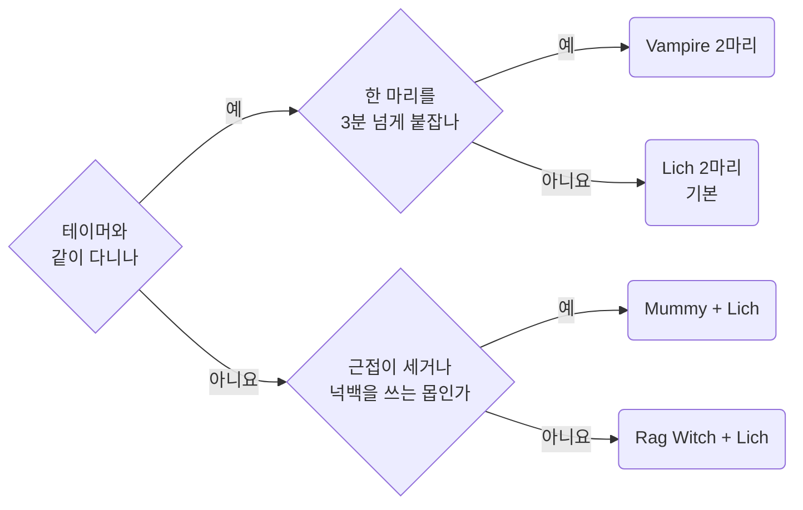
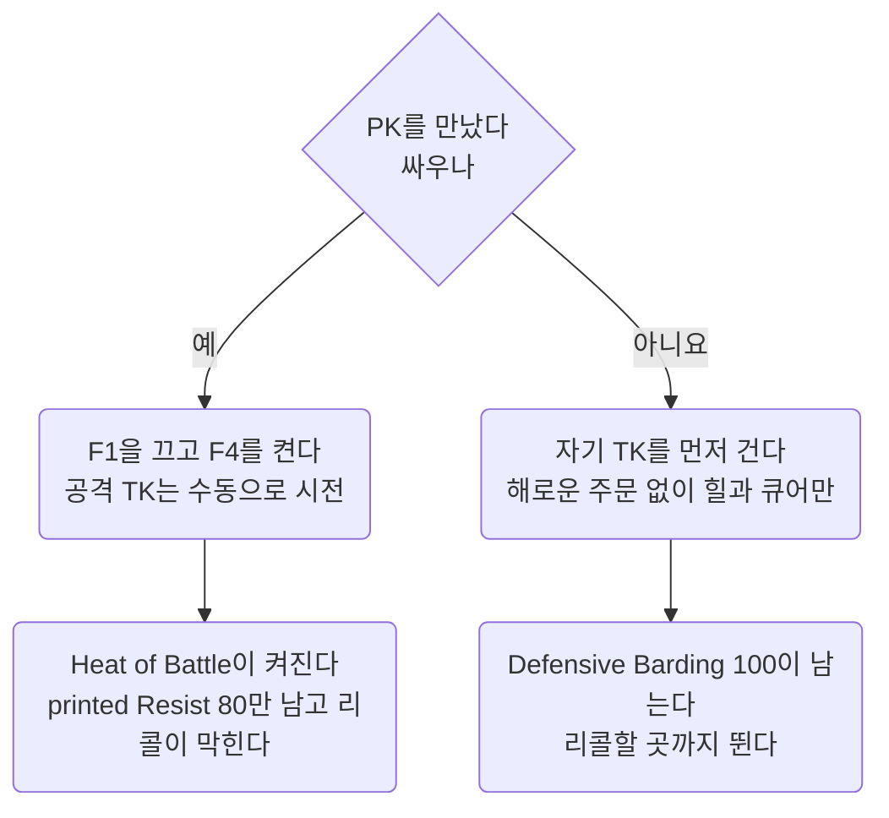

Bard Necro 템플릿의 캐릭터, 코덱스 배분, 소환수 선택, PvP 판단.
**숫자는 추측 금지.** 바드, 네크로, 매저리 규칙의 숫자는 메커니즘 문서, 이 캐릭터의 측정값, 배분, 소환수 숫자는 여기서 인용. 없으면 위키를 읽고 맞는 문서에 추가.
인용과 확인 표시: [Workflow](../working/workflow.md#01.C) 01.C절.

- 캐릭터 `nomeehej`, Razor 프로필 `summoner`. 2026-10-21 nomeehej는 [Bard Archer](bard-archer.md)로 바꾸고 `bard` 프로필로 옮김. 이 루프와 summoner 프로필은 그대로 둠
- 사냥: `script/combat/bard-necro-enhanced.razor`(F1). PK: F4를 다시 연결한 `script/combat/pvp.razor`
- 2026-09-28 `bard-mechanics.md`, `bard-necro-combat-design.md`, `bard-necro-summon-guide.md` 세 문서를 하나로 통합. 이력은 git
- 2026-10-22 메커니즘과 루프 설계를 아래 네 문서로 분리

다른 문서에 있는 것:

- 바드 스킬, 송, 쿨, 코덱스 효과, Defensive Barding: [Barding](../mechanics/barding.md)
- Vengeful Spirit 소환, 언데드, Unholy Symbol: [Necromancy](../mechanics/necromancy.md)
- Magery 프록과 시전 시간: [Magery](../mechanics/magery.md)
- `bard-necro-enhanced` 루프 설계, 소환수 이름과 재소환 블록: [Bard Necro Enhanced](../loops/bard-necro-enhanced.md)
- 인게임 확인 결과와 남은 측정: [Open items](../questions/open-items.md#14) 14절
- 템플릿과 무관한 PvP 규칙과 숫자: [PvP](../game/pvp.md). 04절은 이 캐릭터의 판단만
- Razor 구문, 함정, 명령문 비용: [Razor](../scripting/razor.md)
- 쿨다운 바와 오버헤드의 이름과 색 규칙: [Overheads](../scripting/overheads.md)

## 00 한눈에

| 절 | 내용 |
| --- | --- |
| [01](#01) | 캐릭터 구성과 측정값 |
| [02](#02) | Wizard's Grimoire, Bard Codex, Summoner's Tome 포인트 배분 |
| [03](#03) | 소환 조합. 테이머와 둘일 때, 긴 교전, 솔플 |
| [04](#04) | PK 대응 판단. 도주와 반격, Resist, 소환수, 공통 `pvp` 루프 설정 |
| [05](#05) | 틀렸던 생각 |
| [06](#06) | 출처 |

자주 찾는 곳: 소환 조합 [03.A절](#03.A), PK [04절](#04).
재소환 [Bard Necro Enhanced](../loops/bard-necro-enhanced.md#02.C) 02.C절, 루프 수정 [Bard Necro Enhanced](../loops/bard-necro-enhanced.md#01.A) 01.A절.

이 문서에 걸린 질문은 [Open items](../questions/open-items.md).

::part[캐릭터]

## 01 캐릭터

### 01.A 전제 스킬과 장비

| 스킬 | 값 |
| --- | --- |
| Discordance, Peacemaking, Provocation | 80, 80, 80 |
| Musicianship | **0**. Bard Codex `Self Taught` T2가 대체 |
| Spirit Speak | 120 |
| Resisting Spells | 80. 2026-09-27 Herding 대신 |
| Necromancy | 100 |
| Magery | 100 |
| Eval Int | 80 |

- **바딩 세 스킬 모두 80.** `Self Taught`가 "lowest printed skill amongst Discordance,
  Peacemaking, Provocation" 80점을 Musicianship 대신 사용 → Musicianship 칸이 비어 Provocation 추가 가능
- **Effective Barding 170.** 송 메시지의 `8.5%`로 측정([Barding](../mechanics/barding.md#02.C) 02.C절)
- **Meditation 없음.** 마나는 환급 스택, 이동 중 자연 회복, 버섯
- **Inscription 없음.** Inscription이 늘리는 `Bless`, `Protection` 지속과 `Reactive Armor` 강화 없음.
  Reactive Armor 자체는 Magery로 시전, 루프가 이동 중 유지([Bard Necro Enhanced](../loops/bard-necro-enhanced.md#01.A) 01.A절 자기 버프)
- 장비: Avarhide 스펠북(double mana regen 60%), Eldritch Aspect 8단계(mana refund 26%, special chance 7.2%), Lyric Aspect 방어구
- 소환수 딜 비중 **63.4%**(01.B절 측정), 본체 37%
- 테이머와 둘이 다니는 경우가 많음. **본체는 후열**
- 주 사냥터 몹 난이도 **300\~500**
- PK는 도주보다 반격이 기본 → Herding 대신 Resisting Spells 80(04.B절)
- 소환수는 종류를 알아볼 이름(`leech`, `mumi`, `vampa`, `wichy` 등)으로 자동 개명([Bard Necro Enhanced](../loops/bard-necro-enhanced.md#02.B) 02.B절)

### 01.B 측정 결과

인게임 데미지 트래커 측정값.

| 구성 | 소환수 딜 비중 |
| --- | --- |
| 바딩 120 x3, SS 80, Eval 80 | 47.6% |
| 바딩 80 x3, SS 120, Eval 80 | **63.4%** |

**소환수가 딜의 3분의 2.** 바딩 120보다 SS 120으로 소환수 계수를 키우는 쪽이 훨씬 큼 → 바딩 세 스킬 80의 근거.

- 바딩 최소 성공률 `33% x (Effective Barding / 100)` → 80에서도 쓸 만한 성공률([Barding](../mechanics/barding.md#02.H) 02.H절)
- 난이도 300\~500의 바딩 지속시간은 최소값 `15초 x (Musicianship / 100)`([Barding](../mechanics/barding.md#02.D) 02.D절). Musicianship 120으로 올려도 차이 작음
- 2026-09-27 Herding 제외, Resisting Spells 80. Herding은 팔로워 데미지 `22% x (Effective Herding / 100)`, 저항 `11% x (Effective Herding / 100)`.
  80이면 17.6%와 8.8%. 출처는 옛 스크립트의 `config__use_herding` 주석
- PK와 싸우는 것이 기본 → Heat of Battle 중의 printed Resist가 더 급함(04.B절)

### 01.C 전투 사이클

- 한 마리 전투 → 10\~20초 이동 → 다음 한 마리
- **이동 구간이 전체의 약 4분의 1.** 이 시간에 마나 회복, 버섯 60초 쿨 진행
- 2분짜리 버프는 이 구간에서 낭비 → **2분 버프는 몹이 가까울 때만**
- 스탯 포션을 교전 중에만 마시는 이유도 같음([Bard Necro Enhanced](../loops/bard-necro-enhanced.md#01.A) 01.A절 스탯 포션)

### 01.D 확정 수치, Effective Barding 170

| 항목 | 값 | 출처 |
| --- | --- | --- |
| Barding Song 세 곡 각각 | **8.5%**. 나와 팔로워 | 송 메시지로 측정([Barding](../mechanics/barding.md#02.C) 02.C절) |
| Discordance 디버프 | printed 80이면 `80/120 x 25 = ` **16.7%** | printed 기준([Barding](../mechanics/barding.md#02.B) 02.B절) |
| Discordance 지속 | **1분 21초 \~ 1분 57초** | 측정값. 장비와 대상에 따라 다름 |
| Peace와 Provo의 최소 지속 | `15 x 0.8 = ` **12초** | 난이도 300 이상은 이 값([Barding](../mechanics/barding.md#02.D) 02.D절) |
| Peace와 Provo 실제 지속(난이도 300) | **51초**. 유효 바드 스킬 169, 성공률 72.5% | 프로필 Barding 화면, 인게임 확인됨 2026-10-20(Provocation, Peacemaking 둘 다). 위 최소값 계산보다 훨씬 김 |
| 바딩 최소 성공률 | **56.1%**. Perfect Pitch T3를 더하면 **72.9%** | 공식([Barding](../mechanics/barding.md#02.H) 02.H절) |
| Barding Break(난이도 400) | 초당 **4%**, 걸리면 **40초** | **Peace와 Provo만** 끊음([Barding](../mechanics/barding.md#02.E) 02.E절) |

## 02 코덱스 배분

### 02.A Wizard's Grimoire 40점

| 주문 | 점수 | 효과 |
| --- | --- | --- |
| Magic Arrow | 5 | 15초마다 첫 시전 +250% |
| Harm | 5 | 15초마다 첫 시전 +250% |
| Fireball | 5 | 15초마다 첫 시전 +250% DoT |
| Lightning | 5 | 15초마다 첫 시전 +200%, 힌더 2.5초 |
| Curse | 5 | 대상에게 60초 동안 내 모든 주문 +30% |
| Mana Drain | 5 | 대상에게 60초 동안 적대 주문 환급 +30% |
| Create Food | 5 | 버섯 25마나 / 60초 |
| Energy Bolt | 5 | 데미지 +30%, 5초 안에 죽으면 15마나 회수 |
| 합 | 40 |   |

#### Bless 대신 Energy Bolt

|  | Bless 3 | Energy Bolt 5 |
| --- | --- | --- |
| 얻는 것 | 팔로워 근접 피해, 주문 피해, 공격 속도 각 **5%** | 6서클 주문 **+30%**, 마무리 시 실제 비용 5마나 |
| 전체 딜 기여 | 주문 피해 5% x 소환수 63% = **약 +3.2%** | 15초 창마다 시전 횟수 **약 2배** (4회 → 9회, [Bard Necro Enhanced](../loops/bard-necro-enhanced.md#01.D) 01.D절) |
| 비용 | 2분마다 9마나, 행동 슬롯 1 | 빈 시간 채움. 행동 슬롯 추가 없음 |

- **프록 네 개는 15초 창에서 약 4.3초만 사용.** 남는 10.7초는 버려지던 시간([Bard Necro Enhanced](../loops/bard-necro-enhanced.md#01.D) 01.D절)
- `Energy Bolt`가 그 10.7초를 6서클 주문 +30%로 채움. `Bless`의 `+3.2%`와 비교 불가
- 실제 비용 5마나는 마무리 때뿐. 20을 다 내도 결론은 같음

#### 필러는 Flamestrike가 아닌 Energy Bolt

Magery 100, Eval 80(`0.75 + 0.75 x 0.8 = 1.35`), 위키 PvM 공식으로 계산.

|  | Energy Bolt (Grimoire 5) | Flamestrike (Grimoire 0) |
| --- | --- | --- |
| 마나 | 20, 마무리면 5 | 40 |
| 피해 | 32\~44 x 1.35 x 1.30 = **56\~77**, 평균 67 | 72\~96 x 1.35 = **97\~130**, 평균 113 |
| 시전 | 1.75 + 0.2 | 2.00 + 0.2, 피해 딜레이 0.5 |
| 마나당 피해 | **3.3**, 마무리면 13 | 2.8 |
| 초당 피해 | 34 | **51** |

- 이 루프는 마나가 먼저 바닥남(`config__filler_floor`에서 잘림) → 기준은 **마나당 피해**, EB 우세
- Flamestrike: 시간당 피해 1.5배, 마나 소모 1.8배. Grimoire 5점을 EB에서 빼 와야 DoT 35%
- 잡몹 마무리 시 EB가 15를 회수 → 마나당 13으로 격차 확대. **필러는 EB**
- Flamestrike를 쓰려면 필러 교체 대신 "마나가 높을 때만(예: 80 이상) 체력 큰 몹에 한 방" 별도 분기
- `Magic Reflect`, `Protection`, `Greater Heal`, `Cure` 모두 0점도 맞음. 기본 주문은 포인트 없이 시전, 큐어는 쿨 없는 포션 우선

### 02.B Bard Codex 20점, 지금 배분 유지

| 업그레이드 | 점수 | 효과 |
| --- | --- | --- |
| Self Taught | 3 | Musicianship 80 대체. printed가 80뿐이라 T3(120점)는 낭비 |
| Perfect Pitch | 5 | 성공률 56.1% → 72.9% |
| Refrain | 5 | Barding Break 20% 무시 |
| Ensemble | 3 | +24% |
| Reverb | 3 | +12% |
| Virtuoso | 1 | +4% |
| 합 | 20 |   |

- **이전 판의 `Refrain 5 -> 1` 권고 철회.** 근거 오류
- `Ensemble`은 Peace나 Provo까지 걸려야 켜지고, 그쪽은 브레이크에 끊김([Barding](../mechanics/barding.md#02.E) 02.E절) → `Refrain`이 **`Ensemble` 가동률을 지킴**

#### Ensemble 3에서 5로: 가치 거의 없음

난이도 400, Lyric 방어구 무시 42.5%와 `Refrain` T3 20% 기준 Peace 가동률 약 <strong>62%</strong>.

| 2점 이동 | 효과 |
| --- | --- |
| `Ensemble 3 -> 5` | `+24% -> +40%`. 가동률 62% → 실효 **+9.9** |
| `Reverb 3 -> 1` | `+12% -> +4%`. 가동률 거의 100% → 실효 **-8.0** |
| 합 | 본체 데미지 **+1.9**, 전체 약 **+0.7%** |

**움직일 만한 값 아님.** 지금 배분 유지.

#### 진짜 문제는 배분이 아닌 Peace 가동률

- `Ensemble` 3점이 값을 하려면 **Peace가 계속 걸려 있어야 함**
- 난이도 300 이상 Peace 지속은 최소값 `15 x 0.8 = 12초`, 자기 쿨 10초 → **12초마다 다시 걸면 끊김 없음**
- → 루프의 피스 블록은 대상마다 한 번이 아닌 계속 재시전([Bard Necro Enhanced](../loops/bard-necro-enhanced.md#01.A) 01.A절)
- Peace를 가끔 쓰는 제어 수단으로만 다루면 `Ensemble`, `Virtuoso` 4점이 대부분 놀게 됨
- 브레이크가 뜨면 그 대상에는 Peace도 Provo도 불가([Barding](../mechanics/barding.md#02.E) 02.E절). 난이도 400이면 **40초 동안 `Ensemble`과 `Virtuoso`가 통째로 꺼짐**
- `Refrain`이 막는 것이 이 40초

### 02.C Summoner's Tome 배분

- **소환 주문 하나당 20포인트.** 그 주문으로 소환해 경험치를 쌓아 해금("Players can earn experience and unlock up to 20 Upgrade Points per Summon Spell")
- 주력 소환수를 바꾸면 새 Tome은 처음부터. 티어 비용 누적 `T1=1 / T2=3 / T3=5` → 20점은 **T3 네 개**에 정확히 맞음

모든 Tome에 같은 글로 있는 둘.

> Spirit Pact: "Damage Dealt increased by (3% / 9% / 15%). Damage Resistance increased by (2% / 6% / 10%)."
> "Casting Time of spell reduced by (0.5 / 1.5 / 2.5) seconds" -- 위키 Summoner's Tome

> Dismissive: "Player receives (8 / 24 / 40) Mana when follower is dispelled or killed (must be within 18 tiles)" -- 위키 Summoner's Tome

- Spirit Pact T3 → 소환 시전 6초에서 2.5초 감소. 루프의 시작 마감은 감소 없는 6초 기준([Bard Necro Enhanced](../loops/bard-necro-enhanced.md#02.C) 02.C절)
- Dismissive는 교체용으로 불필요. 판단은 [Bard Necro Enhanced](../loops/bard-necro-enhanced.md#02.C) 02.C절

#### Fire Tome과 Lich, 가장 먼저

주력 조합의 핵심.

| 업그레이드 | 티어 | 점수 | 이유 |
| --- | --- | --- | --- |
| Fanning The Flames | T3 | 5 | Epic Barrage 직접 강화. 체감이 가장 큼 |
| Scorched Earth | T3 | 5 | Hex. 대상 마법 저항을 깎아 Lich 딜과 내 주문 딜 동반 상승 |
| Spirit Pact | T3 | 5 | 전투 성능을 두루 상승. 무난한 기본값 |
| Wildfire | T3 | 5 | 여러 대상을 칠 때 효율 좋음 |
| 합 |   | 20 |   |

- `Glass Cannon` 제외. 딜은 좋지만 어그로를 끌어 Lich 후열 목적과 충돌
- 테이머 펫이 어그로를 확실히 잡는 것이 확인되면 `Wildfire`와 교체 검토

#### Water Tome과 Rag Witch, 솔플용 두 번째

솔플 탱커용. 주문 쓰는 몹 앞에 세우는 기준.

| 업그레이드 | 티어 | 점수 | 효과 |
| --- | --- | --- | --- |
| Reflecting Pool | T3 | 5 | Mirror 15% → 65%, 피해 저항 +10% |
| Spirit Pact | T3 | 5 | 딜 +15%, 피해 저항 +10% |
| Spell Siren | T3 | 5 | 때리는 몹 하나마다 딜과 피해 저항 +10%, 최대 3마리. 어그로를 끄는 탱커와 맞음 |
| Stagnant | T3 | 5 | 주문 40% 확률로 Greater Poison, 대상 독 저항 15초 동안 -40%. 중첩 |
| 합 |   | 20 |   |

- Rag Witch가 자주 죽으면 `Stagnant` 대신 `Deep Water`. 체력 66% 이상일 때 7.5% 회복, 쿨 30초
- `Polluted`(주문 20% 확률로 질병)는 그다음
- Rag Witch의 독이나 질병이 내 Poison Strike에 잡히는지는 확인되지 않았다. 위키 문구는 "you have applied"

#### Earth Tome과 Ancient Mummy, 고 MR 맵과 근접 몹용 세 번째

솔플 탱커 자리는 Rag Witch에 넘김. 물리 딜이 필요한 고 MR 맵(`Mummy + Air`)과 근접이 센 몹용.

| 업그레이드 | 티어 | 점수 | 이유 |
| --- | --- | --- | --- |
| Shatter | T3 | 5 | Pierce 25. 물리 조합의 핵심 |
| Spirit Pact | T3 | 5 |   |
| Bedrock | T3 | 5 | 탱커 성격과 맞음 |
| Slam | T3 | 5 | 근접 몹 상대 시 체감 좋음 |
| 합 |   | 20 |   |

`Earthpull`은 위 넷 다음.

#### Air Tome과 Skeletal Fiend, 고 MR 맵용 네 번째

`Hex`와 `Mana Drain`으로도 저항이 안 깎이는 맵에서 물리 딜로 돌아가는 카드.

| 업그레이드 | 티어 | 점수 | 이유 |
| --- | --- | --- | --- |
| Tempest | T3 | 5 | 가장 중요 |
| Spirit Pact | T3 | 5 |   |
| Gale | T3 | 5 |   |
| Microburst | T3 | 5 |   |
| 합 |   | 20 |   |

`Whirlwind`, `Windshear`, `Cyclone`은 상황을 타서 뒤로.

#### Daemon Tome과 Vampire Thrall, 마지막

`Vampire 2마리`를 실제 주력으로 정한 뒤에만 투자.

| 업그레이드 | 티어 | 점수 | 이유 |
| --- | --- | --- | --- |
| Bloodfuel | T3 | 5 |   |
| Battlecaster | T3 | 5 |   |
| Vengeance | T3 | 5 |   |
| Spirit Pact | T3 | 5 |   |
| 합 |   | 20 |   |

`Growing Fury`는 오래 살 때만 가치. 난이도 300\~500에서 뱀파이어가 오래 사는지는
아직 확인되지 않았다. 위 넷 먼저.

#### 투자 순서

| 상황 | Tome 순서 |
| --- | --- |
| 테이머와 둘이 주로 다닐 때(지금) | Fire → Water → Earth → Air → Daemon |
| 솔플 비중이 늘면 | Water → Fire → Earth → Air → Daemon |
| 고 MR 맵을 자주 돌면 | Fire → Air → Earth → Water → Daemon |

## 03 소환수 선택

### 03.A 무엇을 소환하나

**Magic Resist가 높은 맵이면 누구와 다니든 `Mummy + Air`.** 그 밖의 선택:

PK를 만나도 조합 유지, 사냥하던 그대로 싸움(04.C절).
**지금 쓰는 조합은 `Rag Witch + Mummy`**: 2026-10-18 사용자 결정, `necro/resummon`의 레시피 값([Bard Necro Enhanced](../loops/bard-necro-enhanced.md#02.C) 02.C절). 조합별 이유:

| 상황 | 조합 |
| --- | --- |
| **테이머와 둘(기본)** | **Lich 2마리.** 테이머 펫이 전선을 잡음 → 후열 딜에 모두 투자 |
| 테이머와 둘, 긴 교전 | `Vampire 2마리`. Fury가 3분이면 상한 → 실전에서 쓸 만함 |
| 솔플 | `Rag Witch + Lich`. 탱커 없이 후열만 세울 수 없음. 탱커 자리는 Rag Witch(03.D절) |
| 솔플, 근접이 세거나 넉백을 쓰는 몹 | `Mummy + Lich`. 방어력이 Rag Witch보다 25 높고 넉백 면역(Rooted, 03.D절) |
| 고 Magic Resist 맵 | `Mummy + Air`. **물리 딜이 필요한 유일한 경우** |
| PK를 만났을 때 | 사냥하던 조합 그대로. 근거는 04.C절, 소환수별 PvP 비교는 [PvP](../game/pvp.md#06.B) 06.B절 |

- **Lich, Vampire, Rag Witch는 주문 딜러.** 위키에 Vampire `Spell Damage: 26 - 32`, Rag Witch `Spell Damage: 24 - 30`
- 본체의 `Mana Drain`(`-20 Magic Resist`)과 Fire Tome의 `Hex`가 대상 마법 저항을 깎음 → **셋 모두 이득**
- 물리 딜러는 `Mummy`와 `Air`뿐
- **소환수 스탯은 반드시 SS 120 기준 스케일 표.** 위키 기본 스탯은 낮은 SS 기준이라 실제와 다름

### 03.B 왜 Lich 2마리인가, 테이머와 둘일 때

- 테이머 펫이 어그로를 잡음 → **탱커 소환수 불필요.** 탱커 슬롯(Rag Witch, Mummy)을 딜로 전환
- Lich는 `Epic Barrage`로 원거리 딜. 후열 자리에 맞음
- Fire Tome `Scorched Earth`의 **Hex가 대상 마법 저항을 깎음.** Lich 딜과 내 주문 딜 동반 상승. 본체가 마법을 쉬지 않는 빌드라 즉시 이득
- 내 `Mana Drain`의 `-20 Magic Resist`도 같은 방향. Lich는 주문 딜러라 그대로 받음
- `Epic Barrage` 쿨타임 30초, 관련 감소폭 2.5초 → 그 항목 자체는 결정적이지 않음. Lich를 고르는 이유는 **후열 딜과 Hex 시너지**

### 03.C Lich 2마리와 Vampire 2마리

둘 다 주문 딜러 → `Mana Drain`과 `Hex`를 똑같이 받음. 차이는 **자리와 Fury**.

> **Fury (Innate)**: "Damage Dealt increased by 5% for every 30 seconds alive (max +30%)"

- **분당 5%가 아닌 30초당 5%. 3분이면 상한, 거기서 멈춤**
- "1시간 사냥이니 천천히 쌓여도 된다"는 계산은 오류. 반대로 **3분만 살면 되므로 문턱이 낮음**

|  | Lich 2마리 | Vampire 2마리 |
| --- | --- | --- |
| 자리 | 원거리. `Epic Barrage` | 붙어서 싸우는 주문 딜러. 맞음 |
| 딜 성장 | 없음. 처음부터 최대 | 3분에 **+30%**, 그 뒤 고정 |
| 죽으면 | 뒤에 있어 잘 안 죽음 | **Fury가 0으로.** 다시 3분 |
| Tome 시너지 | `Scorched Earth`의 Hex가 **파티 전체 주문 딜** 상승 | `Bloodfuel`, `Battlecaster`, `Vengeance`는 자기 딜만 |
| `Mana Drain -20 MR` | 적용 | 적용 |

- **기본은 여전히 `Lich 2마리`.** 이유는 Fury가 아닌 **Hex**
- Fire Tome `Scorched Earth`의 마법 저항 감소 → Lich 자신, 내 주문, 테이머의 주문 딜까지 상승. Vampire Tome 업그레이드는 모두 자기 딜만
- `Vampire 2마리`는 **한 마리를 3분 넘게 붙잡는 긴 교전**용
- 지금 사이클(한 마리 잡고 10\~20초 이동)에서는 뱀파이어가 살아서 몹 사이를 넘어가야 Fury 유지. 테이머가 전선을 잡으면 가능
- 몹 교체 시 Fury 유지 여부, 이동 중 "alive" 카운터 진행 여부는 확인되지 않았다. 이동 중에도 돌면 `Vampire 2마리` 평가 상승

### 03.D 솔플

솔플이면 <strong>`Rag Witch + Lich`</strong>.

- 테이머 펫이 없으면 전선을 잡을 것이 필요. 소환수 둘이 동시에 맞으면 둘 다 녹음
- 소환수가 죽으면 다시 뽑아도 송 세 곡은 다음 이동에서야 재적용([Bard Necro Enhanced](../loops/bard-necro-enhanced.md#01.G) 01.G절). **교전 중에는 되돌릴 수 없는 손실**
- 탱커 자리는 **Rag Witch**(Water Elemental)가 Ancient Mummy(Earth Elemental)보다 나음. 2026-09-28 Mummy에서 교체

아래는 위키 스케일 표의 SS 120 열. 표의 열은 `Spirit Speak Skill Base / 80 / 100 / 120 / 150`.
두 소환수가 같은 비율로 커짐 → 차이는 어느 SS에서나 같음. SS 120: HP x2.8, 딜과 Wrestling x1.6, Armor +30, Magic Resist +60.

| SS 120 | Ancient Mummy (Earth) | Rag Witch (Water) |
| --- | --- | --- |
| HP | 1540 | 1540 |
| 딜 | 근접 48 \~ 57.6 | 주문 38.4 \~ 48. 원거리 캐스터(Mage AI) |
| Armor | **105** | 80 |
| Magic Resist | 110 | **210** |
| 독 저항, 특수 저항 | 0%, 0% | **66%, 33%** |
| Wrestling | 152 | 160 |
| 능력 | Rooted | Mirror, Flux |

> "Mirror (Passive): Spells cast onto the creature have a 15% chance to be reflected back onto the caster" -- 위키 Rag Witch

> "Flux (Innate): Creature has an innate 25 parry skill and increased aggro" -- 위키 Rag Witch

> "Rooted (Innate): Creature is immune to Knockback effects and has increased Aggro" -- 위키 Ancient Mummy

- **버티는 힘**: HP 같음, 방어력 25 낮음. 대신 마법 저항 100 높고 독 저항, 특수 저항, 패리 25, 주문 반사.
  난이도 300\~500 몹은 주문, 브레스, 독이 많아 Rag Witch가 오래 버팀
- **딜**: 주문 딜 → 내 `Mana Drain`과 Lich의 `Hex`를 받음(03.A절). 숫자는 Mummy보다 약 20% 낮지만 방어력에 안 깎임
- **Mummy가 나은 곳**: 마법 저항 높은 맵(물리 딜 필요, `Mummy + Air`), 근접이 센 몹(방어력 105 대 80), 넉백 쓰는 몹(Rooted)
- **남은 질문**: Rag Witch는 원거리 캐스터 → 어그로를 끌어도 Mummy처럼 앞에 붙어 서지 않음.
  솔플에서 몹을 본체에서 떼어 놓을 만큼 버티는지는 확인되지 않았다

::part[PvP]

## 04 PvP

서버 규칙과 숫자(Heat of Battle, 명중률, TK 폭탄, 소환수 PvP 규칙)는 [PvP](../game/pvp.md). 여기는 이 캐릭터의 판단만.

- **PK를 만나면 반격.** → Herding 대신 Resisting Spells 80(04.B절), F1을 끄고 F4 PvP 루프(04.F절)
- 소환수는 사냥하던 그대로(04.C절)

- "예" 쪽이 기본. 리콜 가능 위치는 [PvP](../game/pvp.md#01.C) 01.C절
- **바드의 PvP 방어와 도주는 한 조건에 묶임: 다른 플레이어에게 공격적 행동을 하지 않을 것**
- 먼저 손을 쓰면 Defensive Barding과 리콜을 함께 잃음. 이 절의 숫자는 모두 이 조건에서 갈림

### 04.A 도주인가 반격인가

|  | 도주(공격적 행동 없음) | 반격(Heat of Battle) |
| --- | --- | --- |
| 맨손 근접 방어 | Effective Wrestling **100** | printed Wrestling (0) |
| 마법 방어 | Effective Resist **100** (`/ 3`이면 80) | printed Resist |
| 리콜, 문게이트 | 가능 | **불가** |
| printed Resist 80 | 무의미 | **유일한 마법 방어** |

- **printed Resisting Spells: 도주 시 0, 반격 시 유일한 마법 방어**
- PK 대응 방식이 템플릿의 Resist 여부를 결정
- 던전에서는 리콜이 Golden Moongate 8타일 안에서만([PvP](../game/pvp.md#01.C) 01.C절) → 도주는 문게이트까지 맞으며 달리기
- 그동안 공격적 행동이 없으면 Defensive Barding이 방어를 채움

### 04.B Herding을 Resist로 바꿀 것인가

**결론: PK를 만나면 싸우는 것이 기본 → Resisting Spells 80으로 교체**(2026-09-27 결정). 레시피에 `tamer/herding` 없음,
01.A절 전제도 Resisting Spells 80. 사냥이 본업이고 PK가 가끔인 캐릭터라면 Herding이 맞음.

Bard Necro 기준 Herding 80 → Resisting Spells 80 비교:

- 잃는 것은 **늘** 잃음. 팔로워 딜 +17.6%(옛 스크립트의 `config__use_herding` 주석 값)
- 소환수가 딜의 63.4% → 전체 딜 약 -9.5%. 추정식 `36.6 + 63.4 / 1.176`
- 얻는 것은 **반격할 때만.** 도주 중에는 Defensive Barding이 이미 Resist를 줌
- **사냥이 본업이고 PK가 가끔이면 Herding 유지.** 그때 PK 대응 순서:

| 순서 | 행동 | 근거 |
| --- | --- | --- |
| 1 | 빨강이 보이면 **자기 TK** | 상대 TK보다 먼저 |
| 2 | 해로운 주문 금지. 힐과 큐어만 | Defensive Barding(Resist)과 리콜 유지 |
| 3 | Golden Moongate 8타일 안이면 리콜 | 던전 리콜 제한 |
| 4 | 싸울 거면 그때 공격 | 이 순간부터 Heat of Battle. Herding을 둔 Bard Necro는 Resist 0 |

- **싸우는 것이 기본이면 결론이 뒤집힘.** Heat of Battle 뒤의 방어는 printed Resist뿐
- 갈리는 것은 "한 방 덜 맞느냐"가 아닌 **표준 덤프가 풀피에서 죽이느냐**

| PK 메이지 덤프(Eval 100) | Resist 0 | Resist 80 (주문 -10\~30%, 평균 -20%) |
| --- | --- | --- |
| Explosion 31\~40 + Energy Bolt 31\~40 | 62\~80 | 50\~64 |
| 여기에 폭발 포션 21\~35 추가. Alchemy 80, 저항 불가([PvP](../game/pvp.md#05) 05절) | **83\~115** | **71\~99** |

- 체력이 100 언저리면 Resist 0은 덤프 한 번에 사망, 80은 생존 → 힐 포션과 Greater Heal 가능
- 대가는 PvE 전체 딜 약 9.5%. **PK를 만나면 싸우는 것이 기본인 캐릭터에게는 Resist 80**

### 04.C PK 앞의 소환수

- **PK 앞에서도 사냥하던 소환수 그대로.** 그 자리에서 재소환 불가로 판단, PvP의 소환수 간 차이도 사냥 조합을 바꿀 정도가 아님
- PK에는 F4의 `pvp` 루프 → 재소환 없음. 사냥 루프를 그대로 두면 `RESUMMON`이 맞으면서 VS와 6초 시전을 시도([Bard Necro Enhanced](../loops/bard-necro-enhanced.md#02.C) 02.C절)
- PvP에서 소환수가 잃는 것과 더 버티는 소환수: [PvP](../game/pvp.md#06.A) 06.A절, [PvP](../game/pvp.md#06.B) 06.B절

### 04.D 레슬링과 반격 수단

- **바드 메이지의 레슬링은 도주할 때만 Defensive Barding이 채움.** 첫 공격 주문 순간 Heat of Battle → printed 값.
  printed 0의 대가는 [PvP](../game/pvp.md#05) 05절
- 위키의 Discordance, Peacemaking, Provocation 문서는 크리처 대상 효과만. 바드 스킬로 PK를 누르는 수단은 문서에 없음

### 04.E Tracking과 바드

Tracking 규칙은 [Combat](../mechanics/combat.md#05) 05절, Hunting 판정의 5초 스킬 쿨은 [Combat](../mechanics/combat.md#05.A) 05.A절.

- Tracking의 Effective Barding 보너스는 Musicianship(또는 Self Taught 대체값) 상한 안에서만([Barding](../mechanics/barding.md#02.C) 02.C절)
- 서버 스킬 게이트가 하나([Barding](../mechanics/barding.md#01.J) 01.J절) → 사냥 중 Hunting 판정이 바드 스킬을 "use another skill"로 막을 수 있음. 확인되지 않았다

### 04.F 공통 pvp의 mage 설정

- [combat/pvp.razor](https://github.com/minu-ha/uoo/blob/master/script/combat/pvp.razor)는 `config__use_magery = 1`로
  공통 [PvP Loop](../loops/pvp.md)의 자기 마법 사용
- 무기 교체가 필요 없으면 [recipe/pvp-recipe.razor](https://github.com/minu-ha/uoo/blob/master/recipe/pvp-recipe.razor)에서
  `fight/weapon-swap` 줄을 빼고 재조립([Modules](../scripting/modules.md#07.B) 07.B절). 기능별로 켜고 끔, 템플릿 프리셋 없음
- PK를 만나면 F1을 끄고 이것을 켬. 템플릿별 예전 PvP 파일은 삭제 → F4를 Razor에서
  `Play Script: combat\pvp`로 재연결([Hotkeys](../game/hotkeys.md#04) 04절)
- 이 템플릿은 붕대와 무기 옵션을 끔. 공통 레시피가 무기 교체를 기본으로 켜 두므로 직접 끔
- 자동과 수동의 구분, 세부 스위치와 타이머, 손으로 든 커서를 지키는 조건은 공통 문서 [PvP Loop](../loops/pvp.md)이 정본
- 2026-10-05 상대 탐색, Q 대상 캐시, 자동 TK, Explosion에서 EB로 잇기, 소환수 공격 제거
- TK, 공격 주문, 폭발 포션, 소환수 명령은 사용자가 시전하고 타겟. 상대의 색, 거리, 사망은 루프의 실행 조건이 아님.
  Q는 사용자가 손으로 Last Target을 고르는 데만
- 직접 serial을 쓰던 이전 버전에서 alt TK와, Explosion 뒤 EB 잇기 동작 확인(인게임 확인됨 2026-10-04).
  결과는 [Razor](../scripting/razor.md#03) 03절의 진단 근거
- 지금의 공통 자기관리 본문은 아직 인게임에서 확인되지 않았다. 반영과 확인은 [Open items](../questions/open-items.md#10) 10절

::part[기록]

## 05 자주 틀렸던 것

PvP 쪽(명중률, TK 폭탄, 패링, 던전 리콜)은 [PvP](../game/pvp.md#07) 07절.
바딩, 네크로, 매저리 쪽은 각 메커니즘 문서의 자주 틀렸던 것: [Barding](../mechanics/barding.md#04) 04절, [Necromancy](../mechanics/necromancy.md#03) 03절, [Magery](../mechanics/magery.md#03) 03절.
루프 쪽은 [Bard Necro Enhanced](../loops/bard-necro-enhanced.md#03) 03절.

| 틀린 생각 | 사실 |
| --- | --- |
| Provocation은 안 찍음 | **찍었음.** Self Taught가 Musicianship 대체, Disco, Peace, Provo 80, 80, 80 구성 |

## 06 참고 링크

PvP 출처는 [PvP](../game/pvp.md#08) 08절.
바딩, 네크로, 매저리 출처는 각 메커니즘 문서의 참고 링크: [Barding](../mechanics/barding.md#05) 05절, [Necromancy](../mechanics/necromancy.md#04) 04절, [Magery](../mechanics/magery.md#04) 04절.

- [Heat of Battle](https://wiki.uooutlands.com/Heat_of_Battle) -- 공격적 행동의 정의, 자동 반격 예외
- [PATCH: Murderer and PvP Overhaul (2020-09-28)](https://forums.uooutlands.com/index.php?threads/patch-murderer-and-pvp-overhaul-general-changes.3232/)
  -- Heat of Battle 지속시간, Defensive Barding 원래 공식, Telekinesis 포션
- [Resisting Spells](https://wiki.uooutlands.com/Resisting_Spells)
- [Tracking](https://wiki.uooutlands.com/Tracking)
- [TemplatesBard](https://wiki.uooutlands.com/TemplatesBard)
- [Alchemy](https://wiki.uooutlands.com/Alchemy) -- Sticky Potions
- [Summoner's Tome](https://wiki.uooutlands.com/Summoner%27s_Tome)
